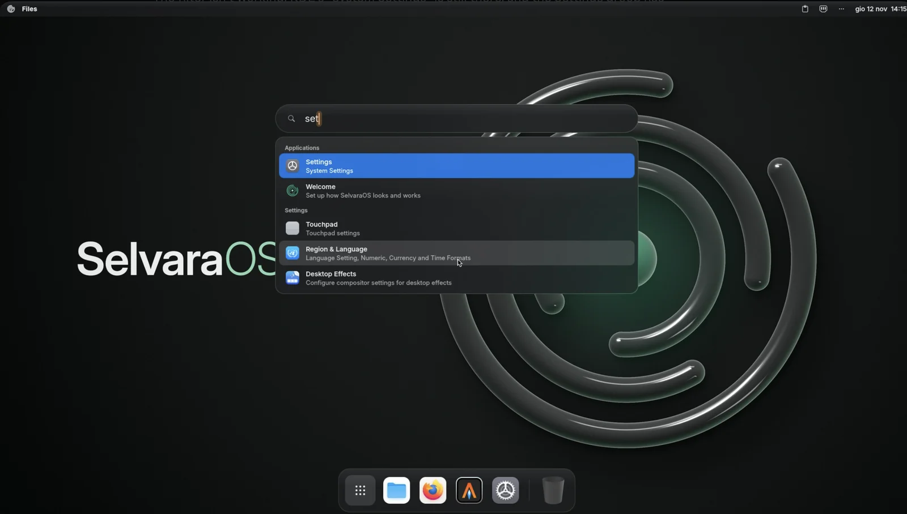
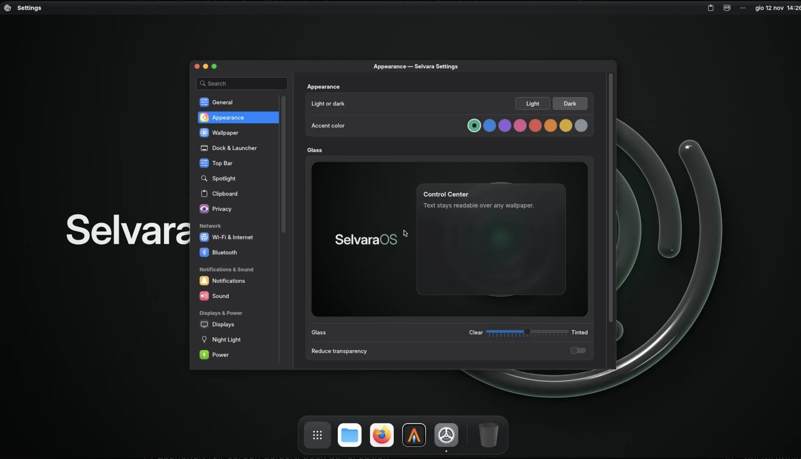
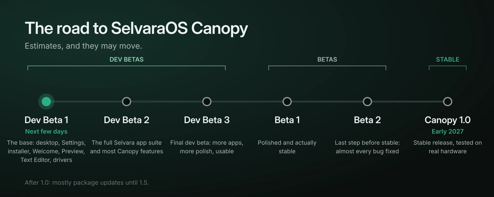

A lot happened this week. The desktop runs, the first installable image boots and installs, and the first test on a real laptop showed us exactly what still needs work. Here is an honest update on where SelvaraOS stands, and the full roadmap to the first stable release.

## What already works

The foundation of SelvaraOS is in place, built from scratch on top of Debian 13 and the KWin compositor.

- **Our own desktop:** the top bar, the dock, the app launcher, search, the Control Center and notifications.
- **Selvara Settings,** with appearance, wallpapers, accent colour, the dock and the launcher.
- **A themed start-up,** from the boot menu to the login screen, with no scrolling text.
- **An installer and a welcome screen** that set everything up in a few steps.
- **Light on resources:** around 1 GB of memory at rest on our 4 GB test machine, and a ready desktop about 3 seconds after login.
- **Private by default:** zero outgoing connections during start-up, login and five minutes at rest, checked automatically on every build.

## What real hardware taught us

Until this week, every test ran in a virtual machine. On Thursday night we installed a development build on a real laptop: a Dell Precision M6800 from 2014, with an older NVIDIA graphics card. That is exactly the kind of computer SelvaraOS is meant to bring back to life, and it found problems no virtual machine could show.

- **Wi-Fi didn't work,** because the image was missing the drivers for common laptop Wi-Fi cards.
- **The desktop stuttered** on the old NVIDIA card, and moving windows quickly caused tearing.
- **The installer was too technical,** and in one case it suggested erasing the whole disk even though other systems were installed.
- **Dozens of small details** weren't good enough: icons, menus, translations, layouts.

We decided not to release a build that makes a bad first impression. Every one of these problems, more than fifty in total, is being fixed before Dev Beta 1 goes out.

## What Dev Beta 1 will include

- **The full desktop,** with new menus for Wi-Fi, Bluetooth, battery and sound, previews in the dock, and a new **Activity Island** at the top of the screen for music, timers, the calendar and quick actions.
- **A new installer** built for beginners: install next to Windows, macOS or another Linux with a simple slider, pick your browser and optional apps, and never risk erasing another system by accident.
- **A full-screen welcome** that walks you through appearance, wallpaper, the dock, shortcuts and privacy.
- **Two new apps:** Selvara Preview for images and PDF files, with annotations and signatures, and Selvara Text Editor, with tabs, code highlighting, Markdown preview and autosave.
- **Drivers that just work:** Wi-Fi cards, modern NVIDIA cards with full effects, and a compatibility mode for older NVIDIA cards that explains clearly what it changes.
- **Six languages:** English, Italian, French, German, Spanish and Dutch.
- **Automatic security updates,** silent and without restarts.

## What it won't include yet

Dev Beta 1 is a beta of the desktop and the system, not the complete operating system. Our own Files app, the Store, Notes, Reminders, Calendar, Keychain, Backup, Drop, Continuity, the Migration Assistant and Network Guard come in the next development betas.

**Please don't install Dev Beta 1 on a computer you depend on.** Try it in a virtual machine or from a USB stick. If you want to install SelvaraOS on real hardware, wait for Dev Beta 2.

## The roadmap

- **Dev Beta 1, in the next few days.** The base of SelvaraOS Canopy, polished and curated. Between Dev Beta 1 and Dev Beta 2 we'll only ship updates for important fixes, with no new apps or features.
- **Dev Beta 2.** The full beta suite of Selvara apps and most of the features that will shape Canopy.
- **Dev Beta 3.** The final development beta: more apps, more polish, actually usable, but still not final or stable.
- **Beta 1.** Dev Beta 3, even more polished, stable, and much closer to the final product.
- **Beta 2.** The last step before the stable release, fixing almost every remaining bug and inconsistency.
- **SelvaraOS Canopy 1.0, planned for early 2027.** Beta 2 after thousands of real-world tests, plus automated smoke and unit tests.

After 1.0, updates will be mostly package updates until version 1.5.

## Help us test

When Dev Beta 1 is out, the most useful thing you can do is try it on your hardware and tell us what breaks. Post in the bug-reports forum on our Discord server, or open an issue on GitHub, with your computer model and the steps that lead to the problem.

Thanks for following along.
