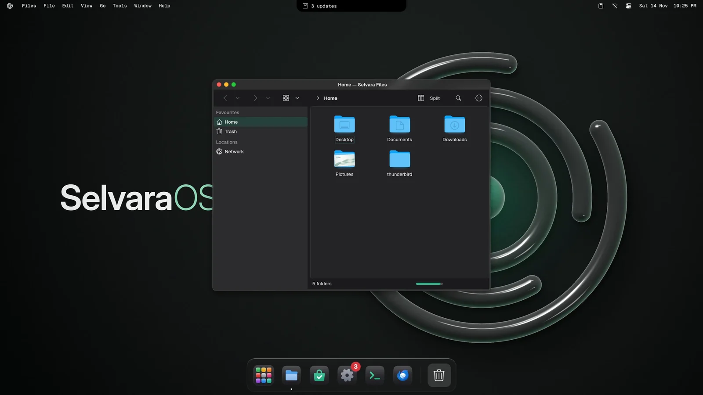
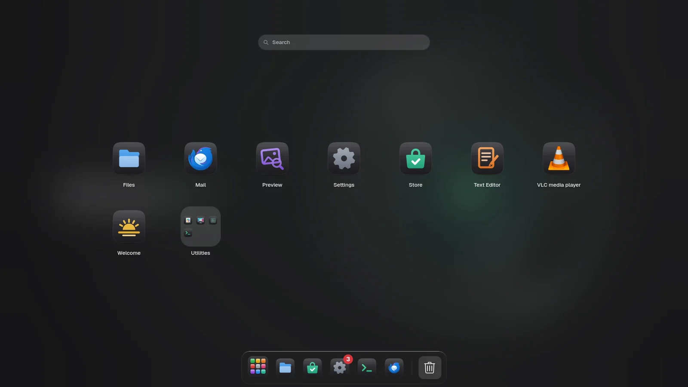
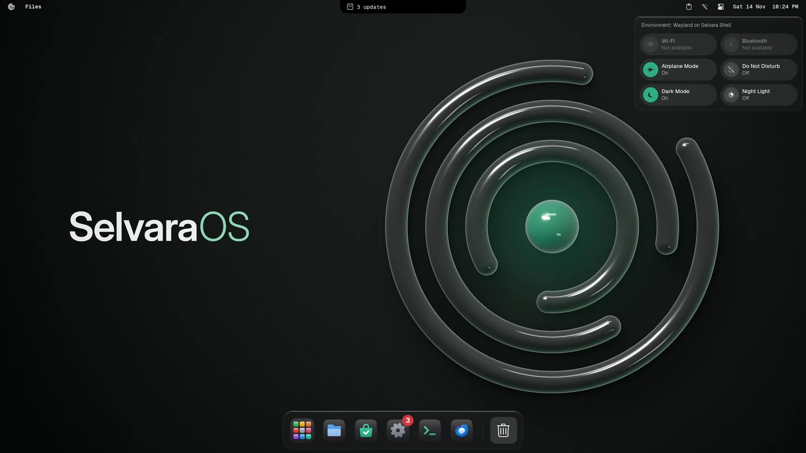
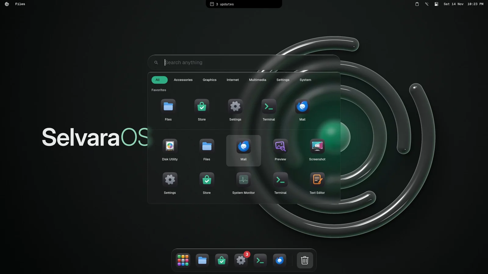
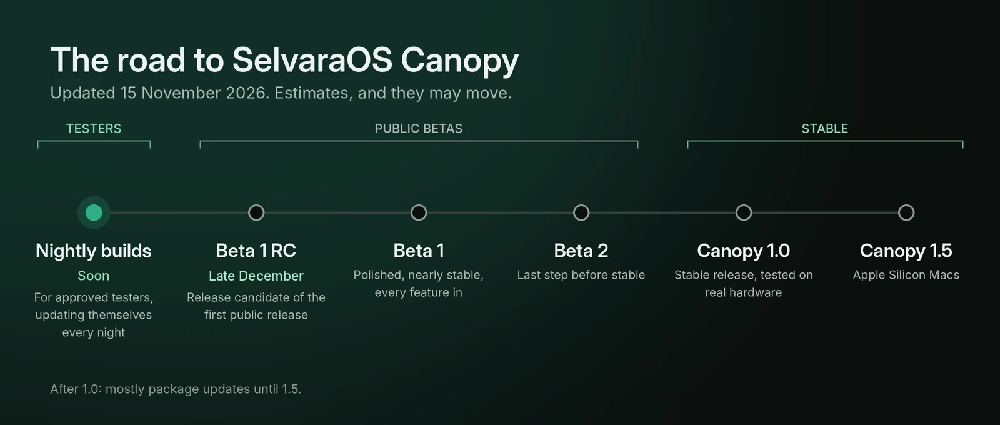

Two days ago we wrote that Dev Beta 1 was coming in the next few days. It isn't. We stopped it before it shipped, and we changed the whole release plan. Here is what changed and why.

## Why we stopped Dev Beta 1

Dev Beta 1 worked. It booted, installed and ran well on our test machines. But when we looked at it honestly, it didn't give anyone a reason to switch. It felt like a promising experiment, not an operating system you'd want on your computer.

A first impression only happens once. So instead of shipping three development betas that grow slowly, we're putting everything into one first release that is complete, polished and nearly stable from day one.

## What Canopy Beta 1 is

**SelvaraOS Canopy Beta 1** will be the first public release. It includes everything that was planned for Dev Beta 1 and Dev Beta 2, plus a lot more:

- **The Selvara apps,** including our own Files app and the Store, alongside Settings, Preview and Text Editor.
- **Windows apps:** Wine is preinstalled, so most `.exe` files open with a double click.
- **Android apps,** through Waydroid, installable from the Store.
- **Gaming** with Steam and Proton.
- **Flatpak** and thousands of apps from Flathub.
- **Drivers for as much hardware as possible,** including older NVIDIA cards.
- **A custom resolution page** in Settings, for screens that don't report the right modes.
- **A new design direction:** quieter, more minimal, with lots of motion and blur, refined and consistent everywhere.

All screenshots come from current development builds, so details may still change.

## Only in SelvaraOS

We also heard, loud and clear, that the early builds looked too much like a copy of macOS. Fair. So Canopy Beta 1 brings features you won't find on any other desktop. A quick taste, with the full reveal coming soon with a video:

- **Rings:** the history of your system as a timeline you can scroll back through.
- **Groves:** saved workspaces that bring back your apps exactly where you left them.
- **Pulse:** see, live, when an app connects to the internet.
- **Undo:** take back system changes, not just text.
- **Shelf:** a place at the top of the screen to drop files and pick them up later.
- **Seed:** your whole setup in one file, ready to bring to a new computer.
- **Canopy light:** a wallpaper and glass that change with the time of day.

## How releases will work

From now on, every release lives on the new [Releases page](../releases.html), betas included. Public releases are free for everyone to download.

Before the public betas, **approved beta testers** get **nightly builds**: install once, and the system downloads a new build every night by itself and installs it when you restart. If you leave the nightly channel, your computer simply stays where it is until the next public beta catches up. No downgrades, no reinstalling.

**Want to test?** [Apply to become a beta tester](https://forms.gle/Z6By2JMZiq7L3i2GA). We'll review every application and email you if you're in.

## The roadmap

- **Nightly builds, soon.** For approved testers only.
- **Beta 1 release candidate, second half of December.** The first build everyone can download.
- **Beta 1.** The release candidate, with the last problems fixed.
- **Beta 2.** The last step before the stable release.
- **SelvaraOS Canopy 1.0.** The stable release, tested on real hardware by real people. No date yet: it ships when it's ready.
- **Canopy 1.5.** Native support for Apple Silicon Macs.

## Help us get there

If you have an older PC, an unusual laptop or a graphics card nobody tests on, you're exactly who we need. [Apply as a beta tester](https://forms.gle/Z6By2JMZiq7L3i2GA), and join the Discord server to follow every step.

Thanks for your patience. We'd rather be late than disappointing.
